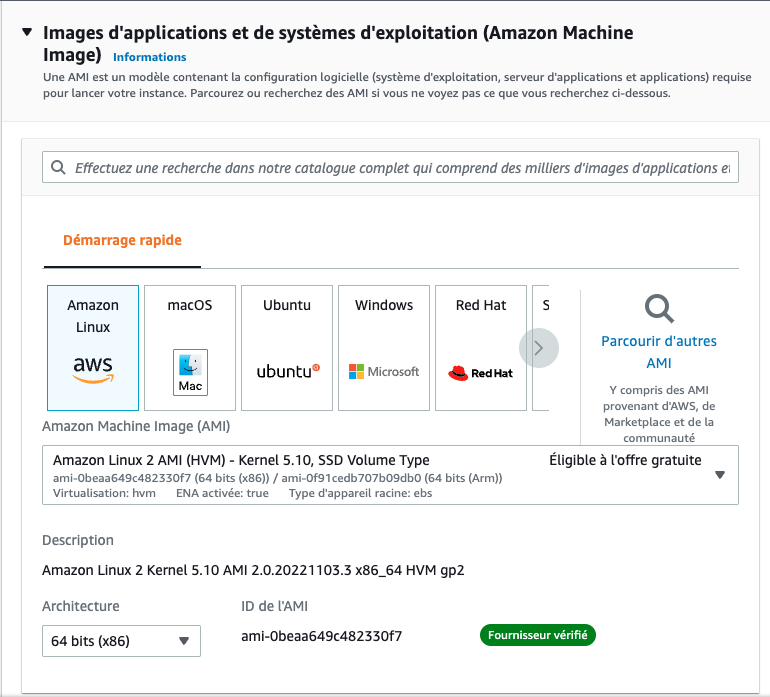
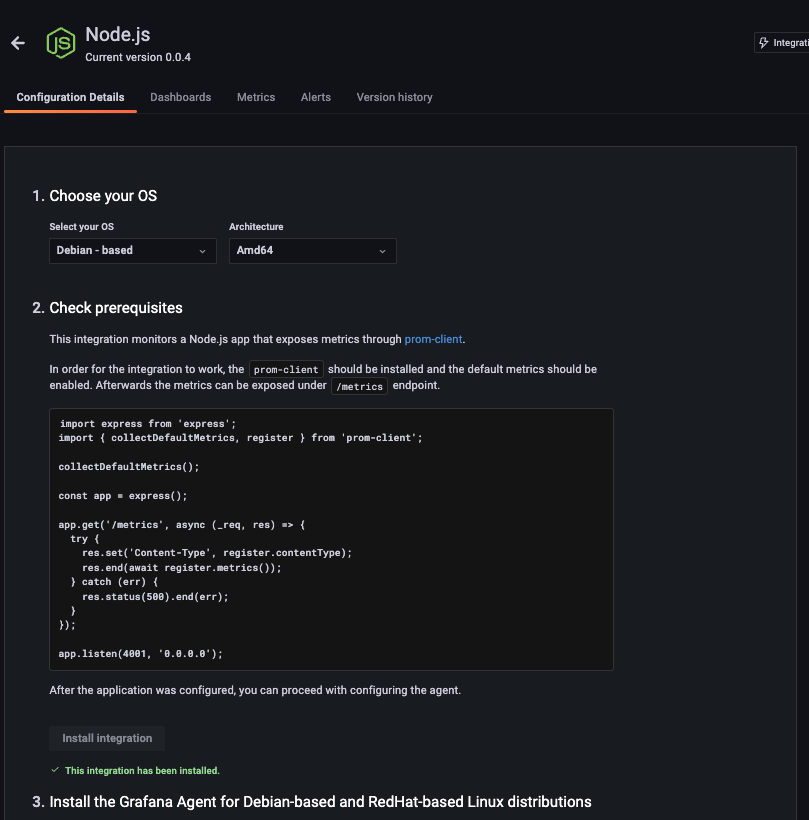

# DevOps Practical Case

## Prerequisites

- Read about Docker Multi-Stage builds  
- AWS Account with a free EC2 instance  
- Grafana Cloud Account  
- GitHub Account  

## Time Estimate

- 1 to 2 hours

## Objective

The goal is to observe how you approach a technical task, understand the problems you encounter, and your method for solving them.

The prerequisites and suggestions are there to save you time, but you may use other tools if you are more comfortable with them.

## Deliverable

A procedure explaining how you implemented the solution. A simple text file is sufficient.

## Exercise

Deploy a web service using Docker in the cloud and collect Node.js metrics in Grafana.

- Clone the project: https://github.com/NeoSpheres/devops-assessment
- Fix the Dockerfile which has a build error:

    ```bash
    docker build -t myapp .
    Sending build context to Docker daemon  4.096kB
    Step 1/9 : FROM node:lts-alpine3.16 as deps
     ---> 6e983a17c040
    Step 2/9 : WORKDIR /app
     ---> Using cache
     ---> d0b422cb8552
    Step 3/9 : COPY package.json ./
     ---> Using cache
     ---> 6e375c946e5c
    Step 4/9 : FROM node:lts-alpine3.16 AS builder
     ---> 6e983a17c040
    Step 5/9 : WORKDIR /app
     ---> Using cache
     ---> d0b422cb8552
    Step 6/9 : COPY . .
     ---> 9efc02c22ddc
    Step 7/9 : COPY --from=deps /app/node_modules ./node_modules
    COPY failed: stat app/node_modules: file does not exist
    ```

- Deploy the container on an EC2 instance:

    

- Collect NodeJS metrics in Grafana by following the integration guide on your Grafana instance:  
  [https://INSTANCE-NAME.grafana.net/a/grafana-easystart-app/nodejs](https://INSTANCE-NAME.grafana.net/a/grafana-easystart-app/nodejs)

    - The container should expose `/metrics` (Step 2)

        

## Bonus

- On GitHub push, automate the container build and push to a registry:
    - Suggestions:
        - GitHub Actions
        - GitHub Registry (`ghcr.io`) or Docker Hub

- Automate container deployment:
    - Suggestions:
        - Ansible
        - GitHub Actions
        - Terraform

- Expose the service on port 443 and secure traffic with HTTPS:
    - Suggestions:
        - Nginx or HAProxy
        - In the Docker container or on the EC2 instance
        - OpenSSL (self-signed certificate)
        - Let’s Encrypt
